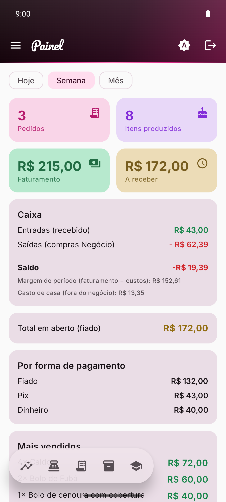
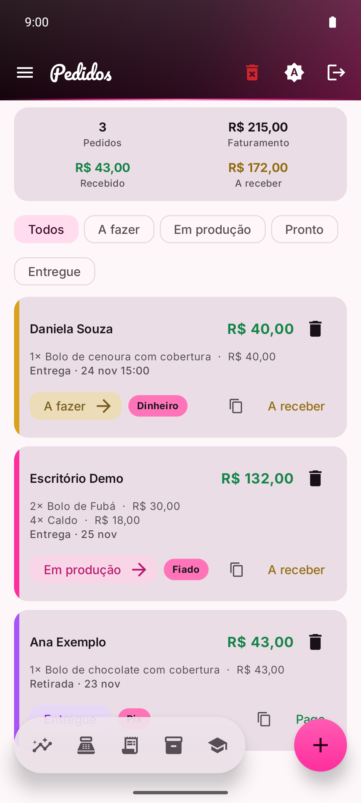
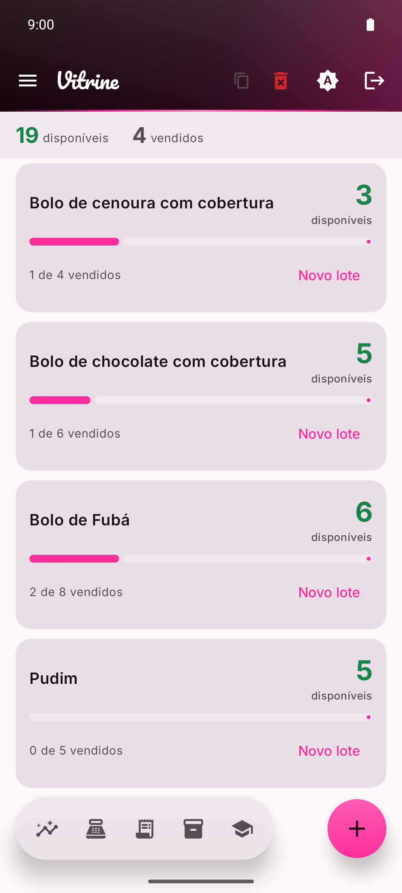
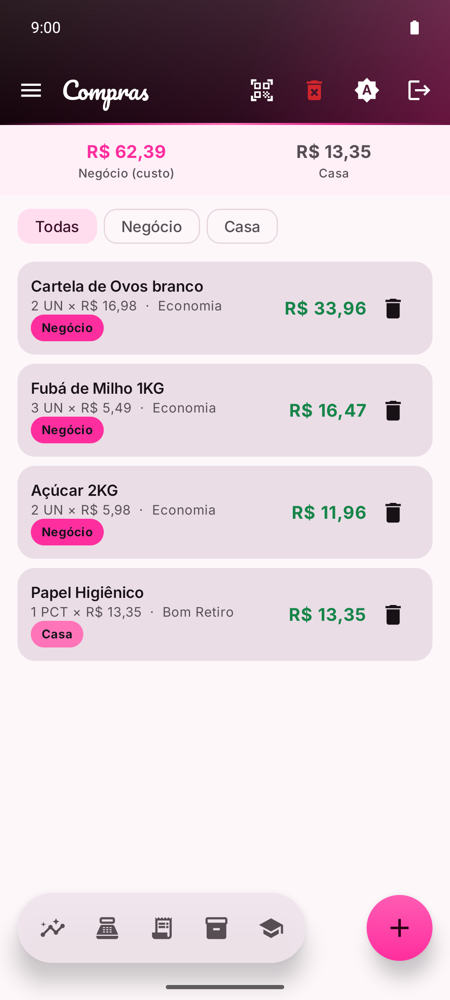
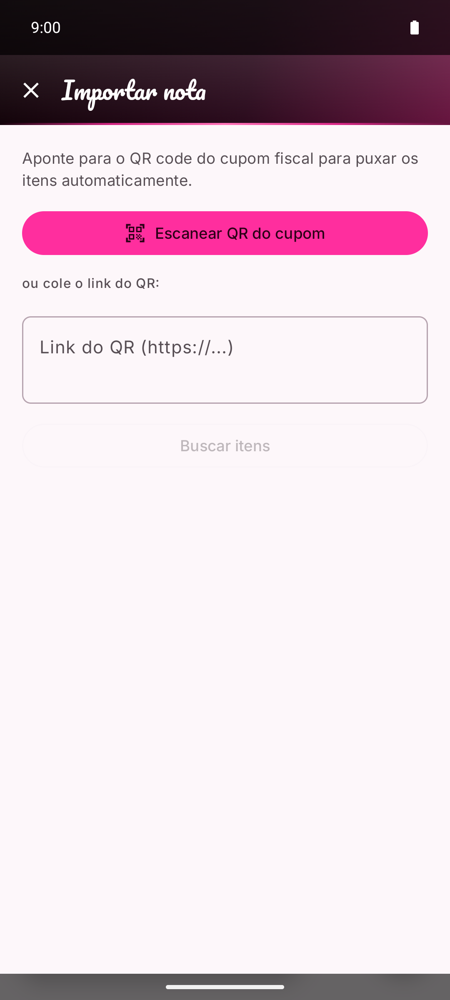
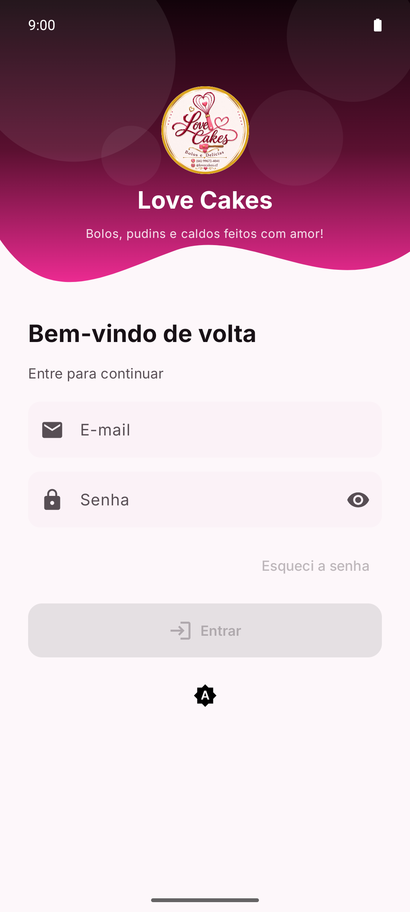

# Love Cakes

App de gestão de uma confeitaria e de uma cantina escolar: pedidos, produção, vendas, pagamentos, fiado, estoque e compras. Criado por mim com desenvolvimento assistido por IA. Em uso pela cliente na versão web.

> O código-fonte é privado porque contém dados reais da cliente. Este repositório apresenta o projeto.

## Destaques
- Importação de nota fiscal (NFC-e) pelo QR Code do cupom, que dá entrada automática no estoque.
- Registro de pedido por voz, processado no próprio aparelho.
- Painel de vendas e produção.

## Números
- Kotlin Multiplatform com 4 alvos: Android, iOS (com widget), Web e Desktop.
- Cerca de 86% do código compartilhado.
- 98 testes automatizados.

## Stack
Kotlin Multiplatform · Compose Multiplatform · Firebase Hosting · Ktor · IA com especificação (SDD e PRD)

## Telas (Android, dados de demonstração)

     

---
**English:** Management app for a bakery and a school canteen. Kotlin Multiplatform (4 targets), ~86% shared code, 98 tests, NFC-e receipt import via QR code, on-device voice order entry. Used by the client on the web.
